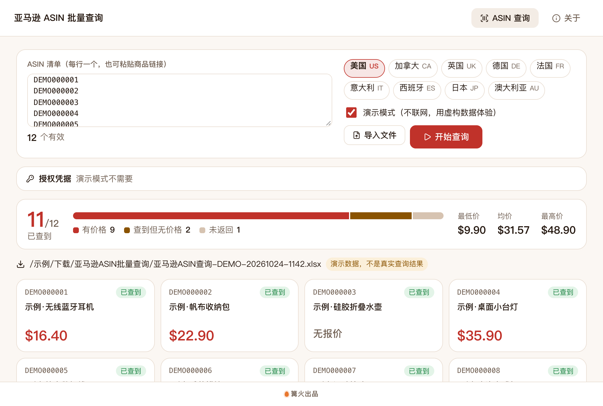

# 亚马逊 ASIN 批量查询

> 篝火出品 · 收录于篝火 App 应用区

批量查商品信息与价格：粘贴或导入一批 ASIN，通过亚马逊**官方 Creators API** 查标题、价格、主图，导出 Excel。

> **合规与风险提示（风险等级：中）**：本工具**不抓取亚马逊网页**。上游项目 tducret/amazon-scraper-python 是网页抓取器，出于合规考虑本工具没有使用它的代码，只调用亚马逊官方接口。使用官方接口需要 Amazon Associates（联盟）账号及其凭据，并遵守其使用条款（条款细节未核实，以亚马逊为准）。查询结果仅供参考，价格以亚马逊页面为准。



## 下载

到 [Releases](https://github.com/campfire-code/amazon-asin-lookup/releases/latest) 下载对应安装包：

| 电脑 | 文件 |
|---|---|
| Windows 10 / 11 | `amazon-asin-lookup_版本号_windows-x64-setup.exe` |
| Mac（Apple 芯片） | `amazon-asin-lookup_版本号_mac-arm64.dmg` |
| Mac（Intel 芯片） | `amazon-asin-lookup_版本号_mac-x64.dmg` |

第一次打开：
- **Windows**：如果弹出「Windows 已保护你的电脑」，点「更多信息」→「仍要运行」。
- **Mac**：如果提示「无法验证开发者」，打开「系统设置 → 隐私与安全性」，在下方点「仍要打开」。

## 怎么用

### 先申请什么

Creators API 用 OAuth 2.0（client_credentials），需要三样东西（官方文档：<https://affiliate-program.amazon.com/creatorsapi/docs/en-us/get-started/using-curl>；申请条件、账号门槛、凭据版本以亚马逊官方页面为准，本工具未代为核实）：

1. **Credential ID** 与 **Credential Secret**：在 Associates 中心为你的账号创建的 Creators API 凭据。
2. **Partner Tag**：你的联盟追踪 ID，形如 `xxx-20`。

凭据版本与区域有对应关系（官方文档：北美 3.1、欧洲 3.2、远东 3.3），工具会按站点自动选用对应区域的令牌地址。旧的 PA-API 5.0 凭据不能直接用于 Creators API（搜索结果中多个迁移指南如此说明，未在官方页面核实）。

### 查询步骤

1. 打开工具，先勾选「演示模式」体验一遍（不联网，商品为虚构的「示例」，文件名带 DEMO）。
2. 取消演示模式，填入三项凭据（只保存在本机应用数据目录的设置文件里，不写日志，只发往亚马逊官方地址）。
3. 选站点；在 ASIN 列表里每行粘贴一个 ASIN（商品链接里的 `/dp/ASIN` 也能识别），或点「导入文件」/ 把 .xlsx、.csv、.txt 拖进窗口，表里所有单元格里符合 10 位字母数字格式的内容都会被当作 ASIN，自动去重。
4. 点「开始查询」。文件保存在「下载」文件夹里的「亚马逊ASIN批量查询」目录，可点「在文件夹中显示」。

### 输出内容

工作表「查询结果」：ASIN、标题、价格、币种、价格显示、状态（已查到 / 未返回 / 失败）、说明、父 ASIN、商品链接、主图；工作表「说明」写明站点、时间与数据来源。

### 说明与限制

- 数据来源只有一个：官方 Creators API 的 getItems（`POST https://creatorsapi.amazon/catalog/v1/getItems`），每次最多 10 个 ASIN，工具自动分批。以上地址、字段、资源名（`itemInfo.title`、`images.primary.medium`、`offersV2.listings.price`、`parentASIN`）和令牌地址已对照官方文档页核实。
- 官方文档对成功响应的容器名前后不一致（参数页写 `itemResults`，cURL 示例写 `itemsResult`），工具两种都能读。
- **未核实**：价格（offersV2）的响应结构官方示例里没有给出，工具按 `listings[].price.money.{amount,currency,displayAmount}` 容错读取，读不到就留空、在说明里提示；错误数组的内部结构、请求频率限额（官方「API Rates」页未查阅）、各站点域名（按常规域名填写）、ASIN 的官方格式定义。请求间隔 1.1 秒、遇 429/5xx 退避重试，是本工具的保守取值，不是官方限额。
- 本工具的测试使用按官方文档结构编写的模拟响应，**没有用真实凭据验证过**，真实账号下的表现未核实。
- 只做标题、价格、主图、父 ASIN 四类信息，不含库存数量、评论、排名。

## 验收用例

无需凭据，用演示模式（演示数据均为虚构）：

1. 打开工具，保持勾选「演示模式」，点「开始查询」（ASIN 列表为空时自动用 12 个演示 ASIN）。应得到：共查询 12、已查到 11、有价格 9、未返回/失败 1（DEMO000009 为「未返回」）；生成 `亚马逊ASIN查询-DEMO-…xlsx`，工作表「查询结果」12 行加表头、「说明」一张，首行加粗冻结。
2. 点「导入文件」选 `samples/asin-list.csv`，列表出现 4 个有效 ASIN（DEMO000001、2、3、9），`abc` 与表头被忽略；再点「开始查询」，得到 4 行。
3. 清空列表，打开 `samples/asin-links.txt` 的内容粘贴进去（或导入），应识别出 DEMO000004、DEMO000005 两个。
4. 取消演示模式、不填凭据点「开始查询」，应提示「请先填写凭据编号、凭据密钥和联盟追踪标识」，不发出任何请求。
5. 自动化验收：`pnpm test`，22 个用例覆盖 ASIN 解析、请求体、分批、令牌复用、429 退避、401、单批失败、停止、Excel 读回。
6. 真实账号验收（需要你自己的凭据，作者未做）：用 3～5 个已知 ASIN 查询，对照亚马逊页面核对标题与价格。

## 自己编译

需要 Node.js 22、pnpm、Rust。

```bash
pnpm install
pnpm test          # 单元测试
pnpm tauri dev     # 开发运行
pnpm tauri build   # 打包
```

界面框架在 `src/kit`（所有 campfire-code 工具共用），本工具的逻辑在 `src/tool`。

## 致谢

本工具的目录里原列的上游是 [tducret/amazon-scraper-python](https://github.com/tducret/amazon-scraper-python)（MIT，网页抓取器）。出于合规考虑，本工具没有使用它的代码，只借鉴「按 ASIN 批量取商品标题与价格」的需求；数据全部来自亚马逊官方 Creators API。

## 归属

本工具由**篝火**出品，是篝火 App 应用区收录的开源工具之一，由篝火（GitHub 组织 [campfire-code](https://github.com/campfire-code)）维护与更新。全部工具的目录见 [toolkit-hub](https://github.com/campfire-code/toolkit-hub)。

## 许可证

MIT，版权方为篝火（campfire-code）。
